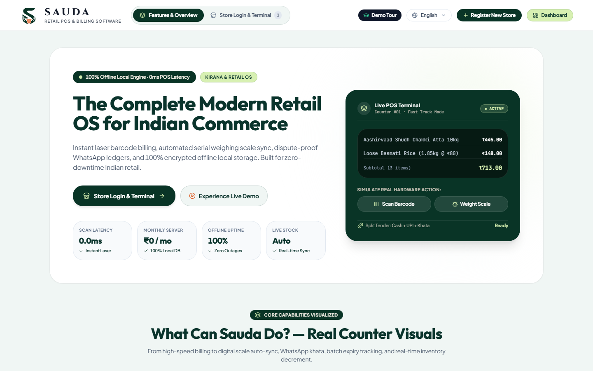
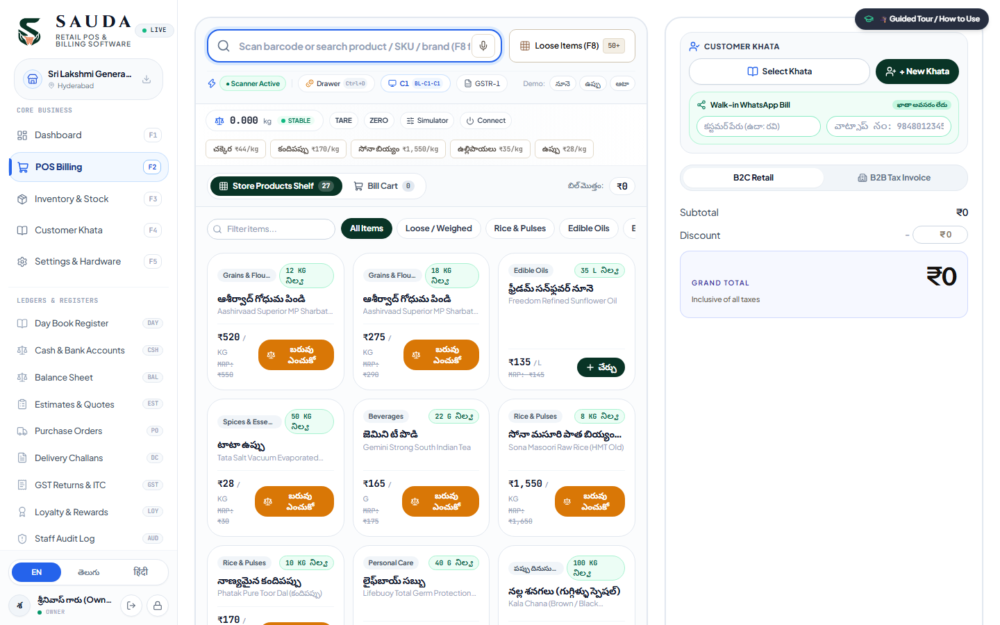
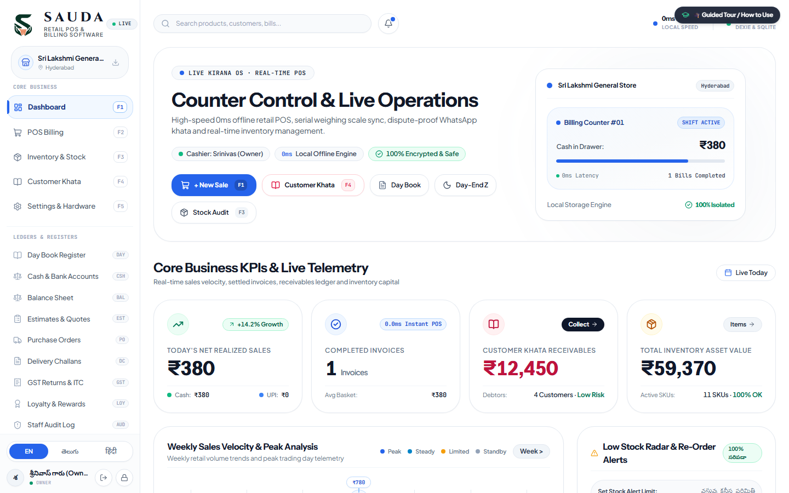
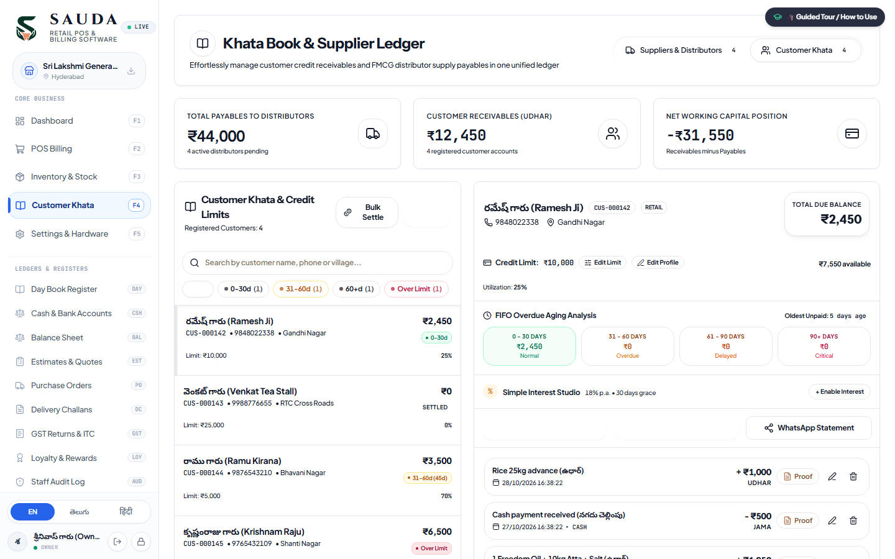
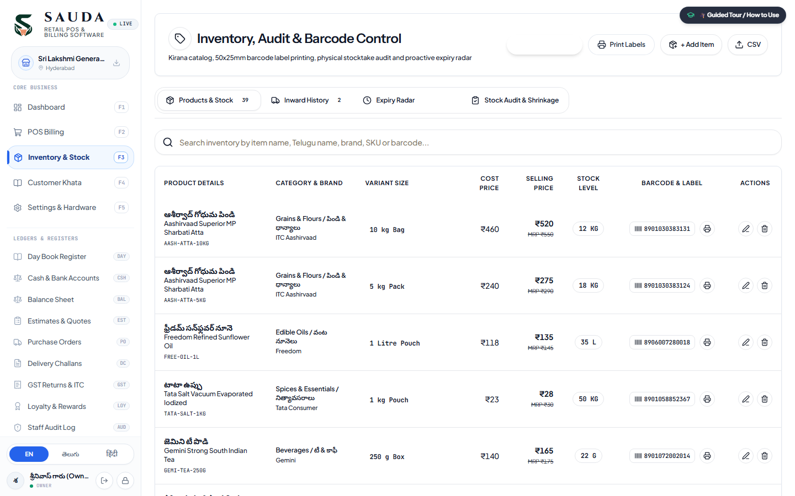
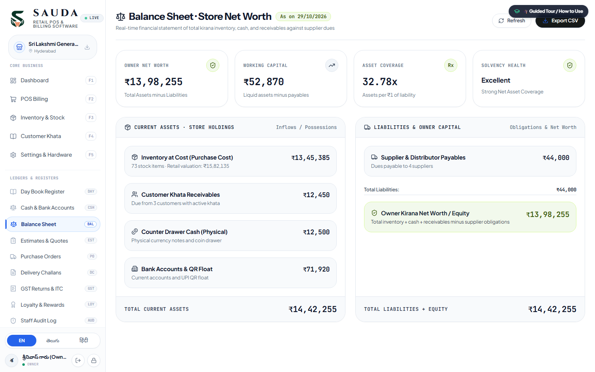

<div align="center">

<picture>
  <source media="(prefers-color-scheme: dark)" srcset="public/brand/sauda_official_lockup_dark.svg">
  <source media="(prefers-color-scheme: light)" srcset="public/brand/sauda_official_lockup_light.svg">
  
</picture>

<p align="center">
  <strong>Next-Gen Offline-First Kirana &amp; Retail Management ERP</strong><br>
  <em>Engineered for Indian Kirana Stores, FMCG Supermarkets, and General Provision Retailers</em>
</p>

[](./LICENSE)
[](https://www.typescriptlang.org/)
[](https://react.dev/)
[](https://dexie.org/)
[](https://tailwindcss.com/)
[](https://playwright.dev/)

---



</div>

---

## 🌟 Overview

**SAUDA (సౌదా / सौदा)** is a high-performance, offline-first Point of Sale (POS), customer Khata ledger, and inventory ERP built specifically for Indian retail ecosystems. Designed to run directly in modern browsers without requiring active cloud connections, Sauda ensures 0ms latency during peak store hours while safeguarding all transactional data locally.

### Key Highlights
* **100% Offline-First Architecture:** Powered by Dexie.js (IndexedDB v7) with resilient compound indexing and zero internet requirement for billing.
* **Rapid POS Billing Terminal:** High-throughput barcode scanning, keyboard navigation, weighing scale integration, and instant UPI QR payments.
* **Double-Entry Khata & Credit Aging:** Track customer balances, supplier payables, and 30/60/90+ day aging reports with 1-click WhatsApp reminders.
* **Hardware Plug-and-Play:** Built-in protocol drivers for Barcode Scanners, ESC/POS Thermal Printers, Solenoid Cash Drawers, and RS-232 Digital Weighing Scales.
* **Statutory GST Compliance:** Automated CGST/SGST/IGST calculations, B2B tax invoice generation, and GSTR-1 compliant reporting.

---

## 📸 Visual Showcase & Feature Tour

### 1. 🛒 Next-Gen Fast POS Billing Terminal
*Rapid product search, hardware wedge barcode scanner input, real-time weighing scale LED HUD, and instant payment settlement.*

<div align="center">
  
</div>

---

### 2. 📊 Store Analytics & Real-Time KPI Dashboard
*Daily turnover, gross profit margins, low stock alerts, top-performing inventory, and cash vs. UPI collection breakdown.*

<div align="center">
  
</div>

---

### 3. 📖 Double-Entry Khata & Customer Aging Analysis
*Customer credit limits, supplier outstanding balances, 30/60/90+ day credit aging analysis, and 1-click WhatsApp payment reminders.*

<div align="center">
  
</div>

---

### 4. 📦 Product Catalog, Barcode Stickers & Physical Audit
*Batch management, MRP vs Selling Price tracking, barcode label printing, and expiry date radar.*

<div align="center">
  
</div>

---

### 5. 📑 Financial Balance Sheet, Daybook & Statutory GST Studio
*Real-time Assets vs Liabilities calculation, Daybook cash-flow audits, B2B tax invoicing, and GSTR-1 compliant filing exports.*

<div align="center">
  
</div>

---

## 🔌 Hardware Integration Suite

| Hardware Device | Communication Protocol | Key Capabilities |
| :--- | :--- | :--- |
| **Barcode Scanner** | Zero-latency Keyboard Wedge | Automatic UPC/EAN-13 detection with 1250Hz audio chime confirmation |
| **Thermal Printer** | ESC/POS (USB / Bluetooth) | Dual 80mm & 58mm bill layouts with dynamic UPI QR code generation |
| **Cash Drawer** | RJ11 Solenoid Kick Pulse | Automated drawer kick upon cash payment & PIN-protected audit log |
| **Weighing Scale** | RS-232 (Web Serial API) | Continuous weight stream parser (Phoenix, Essae, Eagle) with stable tone |

---

## 🏗️ Technology Stack

* **Frontend Framework:** React 19, TypeScript, Vite
* **Styling & Design System:** Tailwind CSS with custom Kirana luxury tokens
* **Local Persistence Engine:** Dexie.js (IndexedDB v7) with high-performance compound indexing
* **Testing & Verification:** Playwright E2E automation test suite
* **Icons & Animation:** Lucide Icons, Motion (Framer Motion v12)

---

## 🚀 Getting Started

### Prerequisites
* **Node.js**: v20.0 or higher
* **npm**: v10.0 or higher

### Installation & Launch

```bash
# 1. Clone repository
git clone https://github.com/anas116-ai/Sauda.git
cd Sauda

# 2. Install dependencies
npm install

# 3. Launch development server
npm run dev
```

Visit `http://localhost:5173` in your browser to experience Sauda.

---

## 📜 License

This project is licensed under the **MIT License** — see the [LICENSE](./LICENSE) file for details.

Developed with ❤️ for Indian Retailers & Kirana Entrepreneurs.
